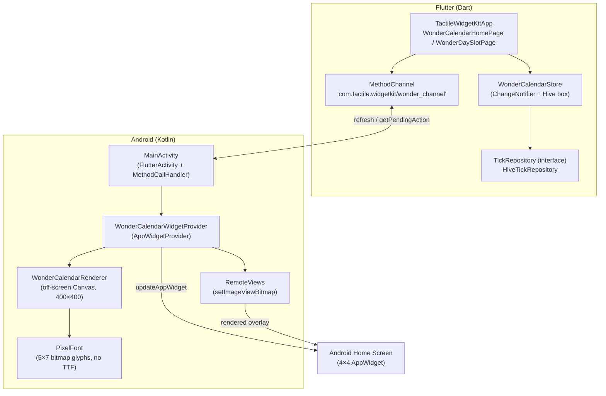

# Tactile Widget Kit

> A production-grade Flutter starter kit for native Android home-screen widgets,
> off-screen pixel rendering, and tactile skeuomorphic UI with chained choreography.

<p align="center">
  <a href="https://github.com/davidzhang0258-cloud/tactile_widget_kit/blob/main/LICENSE"></a>
  <a href="https://github.com/davidzhang0258-cloud/tactile_widget_kit/actions/workflows/ci.yml"></a>
  <a href="https://flutter.dev"></a>
  <a href="https://dart.dev"></a>
  <a href="https://developer.android.com/develop/ui/views/appwidgets"></a>
  <a href="https://github.com/davidzhang0258-cloud/tactile_widget_kit/pulls"></a>
</p>

---

## Why this project

Building a Flutter app that also needs a **native Android home-screen widget** is
surprisingly painful. The standard path forces you to:

- hand-wire a `MethodChannel` between Dart and a Kotlin `AppWidgetProvider`;
- work around the `home_widget` plugin's package-name resolution quirks;
- render pixel-perfect content **off-screen** without shipping a font asset;
- avoid `RemoteViews`'s ~1&nbsp;MB `Binder` transaction limit when pushing bitmaps;
- choreograph multi-stage UI motion that stays in sync with haptics and focus.

**Tactile Widget Kit** is a distilled, runnable reference implementation that solves
all of the above. It packages a working `Flutter ↔ Kotlin AppWidget` bridge, a
self-contained 5×7 bitmap pixel-font engine, an off-screen `Canvas` renderer with
resource-safe bitmap caching, and a three-layer tactile console UI with a
four-stage serial insertion animation — all decoupled behind clean
Repository/Store boundaries.

Use it as a **starter template** for your own widget-driven app, or lift individual
modules (the renderer, the bridge, the pixel font) into an existing project.

## Architecture



The rendering pipeline is the core value: the Dart side holds state, the Kotlin
side owns a pure `Canvas` renderer that draws a 400×400 transparent overlay
(keeping the bitmap far below the `Binder` limit), and only that lightweight
overlay crosses back into `RemoteViews`.

## Key features

- **Native AppWidget bridge** — a working `MethodChannel` + `AppWidgetProvider`
  round-trip with `home_widget`, including the `qualifiedAndroidName` fix that
  avoids the plugin's package-name mis-resolution.
- **Off-screen pixel renderer** — a pure-Kotlin `Canvas` renderer with a
  self-contained 5×7 bitmap font (no `.ttf` dependency) and cached sprite bitmaps.
- **Binder-safe bitmap delivery** — a 400×400 overlay that sidesteps the
  ~1&nbsp;MB `TransactionTooLargeException` trap.
- **Repository + Hive architecture** — a storage-agnostic `TickRepository`
  contract with a pure-Dart Hive implementation, ready to swap for SQLite/Isar.
- **Tactile skeuomorphic UI** — a three-layer `Stack` console with chained
  four-stage insertion animation, haptic feedback, and keyboard focus choreography.
- **Deep-link from widget** — widget hot-zones launch straight into a specific
  in-app screen with `FLAG_ACTIVITY_NEW_TASK | CLEAR_TOP`.

## Quick start

```bash
# 1. Clone
git clone https://github.com/davidzhang0258-cloud/tactile_widget_kit.git
cd tactile_widget_kit

# 2. Install dependencies
flutter pub get

# 3. Analyze and test
flutter analyze
flutter test

# 4. Run on a device/emulator
flutter run
```

To add the widget: long-press the launcher, add a widget, and select
**Tactile Widget Kit** (4×4).

## Project structure

```
lib/
├── main.dart                      # Immersive root + widget deep-link routing
├── data/
│   ├── models.dart                # HabitTick domain model (generic)
│   ├── repositories.dart          # TickRepository contract
│   └── hive_repositories.dart     # Hive-backed implementation
├── services/
│   └── notifications.dart         # Local notification scheduling
└── ui/
    ├── wonder_console_pages.dart  # Tactile console UI + choreography
    └── widget_test_page.dart      # Widget bridge smoke-test page

android/app/src/main/kotlin/com/tactile/widgetkit/
├── MainActivity.kt                # FlutterActivity + MethodChannel handler
├── TestWidgetProvider.kt          # Base widget provider (2×2 / 4×2 / 4×4)
└── wonder/
    ├── WonderCalendarWidgetProvider.kt  # AppWidgetProvider + deep links
    ├── WonderCalendarRenderer.kt        # Off-screen Canvas renderer
    ├── WonderCalendarState.kt           # Month-offset persistence
    ├── WonderCalendarModel.kt           # Event model + mock data
    └── PixelFont.kt                     # 5×7 bitmap font engine
```

## Roadmap

- [ ] **AI-assisted scheduling** — plug an LLM into the `TickRepository` seam to
      suggest habit/task entries from natural-language input.
- [ ] **Golden-file renderer tests** — snapshot the off-screen `Canvas` output
      to catch pixel regressions automatically.
- [ ] **Rendering performance harness** — benchmark the overlay pipeline and
      move expensive work off the main isolate.
- [ ] **Widget configuration screen** — add `AppWidgetProviderInfo.configure` to
      let users pick a theme before pinning the widget.
- [ ] **iOS Live Activities / widgets** — extend the bridge abstraction to cover
      Apple's widget surface.

## License

MIT — see [LICENSE](./LICENSE).
